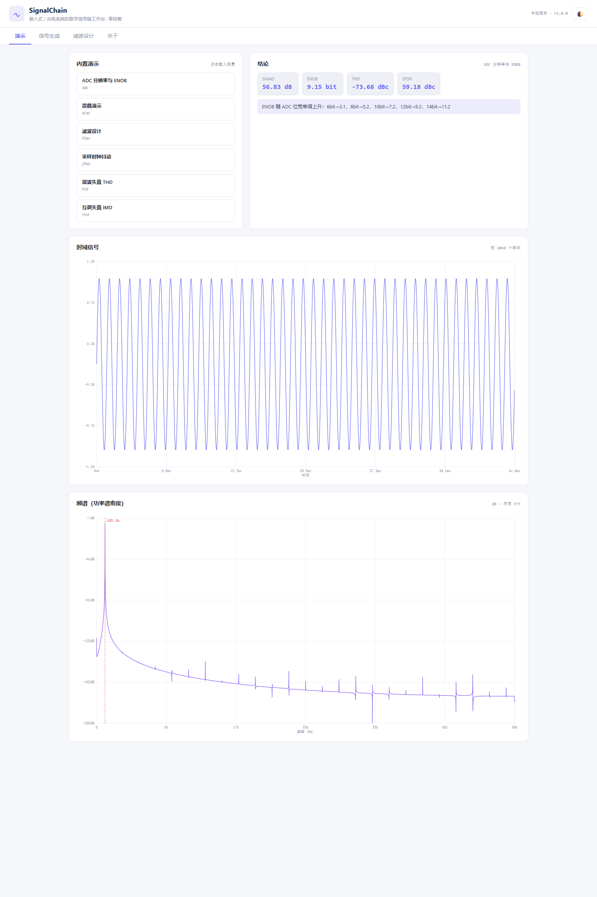
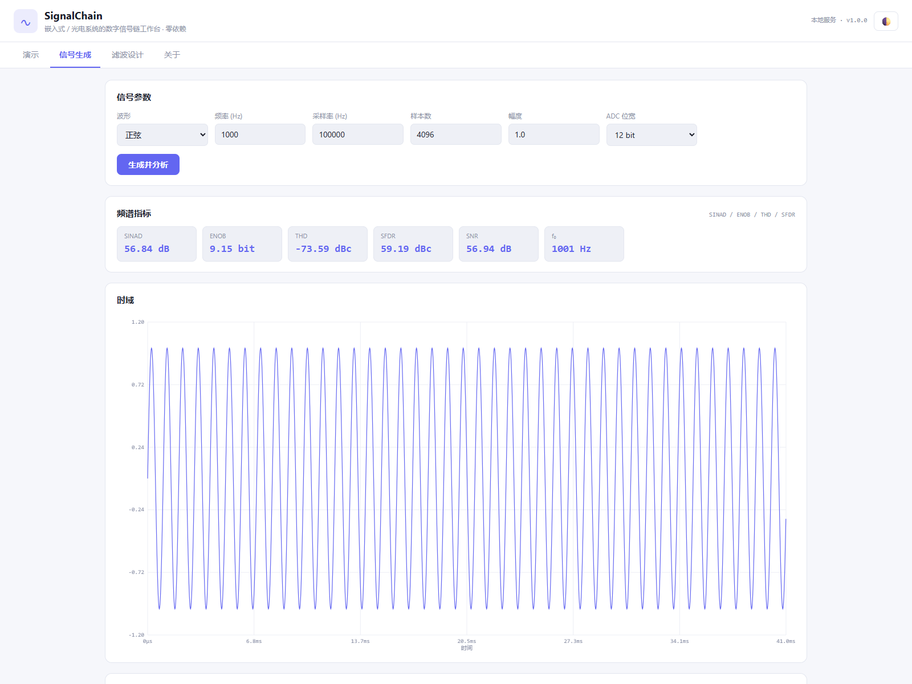
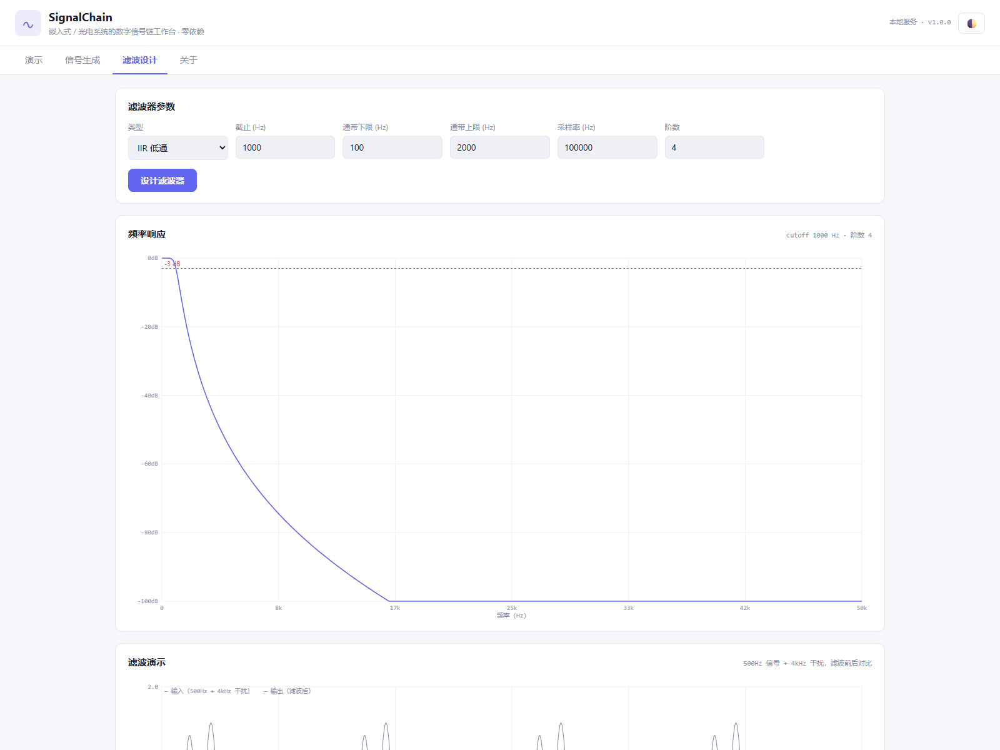

# SignalChain ∿

**面向嵌入式与光电系统的 DSP 信号链工作台** — 手写 FFT、FIR/IIR 滤波器设计、ADC 建模与频谱指标测量，零第三方依赖。

<p align="center">
  
  
  
  
</p>



> 嵌入式与光电系统调试中最常见的问题：**ADC 采出来的信号到底"干净"到什么程度？**
> 示波器只给波形，不会告诉你 SINAD 是 56 dB 还是 74 dB、ENOB 掉了几个 bit、
> 4 kHz 的干扰是被滤波器压掉的还是混叠进来的。SignalChain 把这条链路完整地搬到了本地浏览器里：
> 生成信号 → ADC 量化 → 数字滤波 → 频谱分析，每一步的物理后果都变成可读的数字。

---

## 功能总览

| 能力 | 说明 |
| --- | --- |
| **手写 FFT** | 基-2 迭代 Cooley–Tukey（位反转 + 蝶形），与朴素 DFT 逐 bin 对比误差 < 1e-9 |
| **窗函数** | Hann / Hamming / Blackman / Blackman-Harris / Kaiser / Flattop / Bartlett，附相干增益与 ENBW |
| **FIR 设计** | 窗函数法低通 / 高通 / 带通 / 带阻，任意阶数 |
| **IIR 设计** | Butterworth 双线性变换（含频率预畸变），低通 / 高通 / 带通，级联 biquad 保证数值稳定 |
| **ADC 建模** | 位宽、参考电压、偏置、增益误差、采样时钟抖动、dither、双极性/单极性 |
| **频谱指标** | SINAD、SNR、ENOB、THD、SFDR、双音 IMD3 |
| **采样理论** | 混叠频率计算、无滤波抽取 vs 抗混叠抽取、过采样插值 |
| **信号源** | 正弦 / 方波 / 锯齿 / 三角 / 线性与对数扫频 / 多音 / AM / FM / 白噪声 / 粉红噪声 |
| **三种入口** | `sigchain` CLI · `import sigchain` API · 本地 Web 工作台 |

## 为什么是"零依赖"

市面上同类工具要么是黑盒库（scipy.signal 一行出结果，但不解释发生了什么），
要么需要 MATLAB 授权。SignalChain 的每个算法都可以在 IDE 里点进去读完——
基-2 FFT 约 40 行，Butterworth 设计约 50 行，量化器约 30 行。
**它既是工具，也是一份可运行的 DSP 教材**，适合光电 / 仪器 / 嵌入式课程的教学演示与个人项目参考。

<table>
<tr>
<td width="50%"></td>
<td width="50%"></td>
</tr>
<tr>
<td align="center"><sub>信号生成：12-bit 量化后 SINAD / ENOB / THD / SFDR 一目了然</sub></td>
<td align="center"><sub>滤波设计：IIR 低通频响 + 前后波形对比（4 kHz 干扰被滤除）</sub></td>
</tr>
</table>

## 快速开始

### 环境要求

- Python ≥ 3.9（**无需 pip install 任何东西**）
- 浏览器（Web 工作台用；CLI 与 API 无此要求）

### 安装与运行

```bash
git clone https://github.com/18971181532/sigchain.git
cd sigchain

# Web 工作台（推荐）
python run.py serve                 # 打开 http://127.0.0.1:8779

# CLI
python run.py demos                 # 列出 6 个内置演示
python run.py run adc               # ADC 分辨率 → ENOB 扫描
python run.py run alias             # 60 kHz 信号混叠到 40 kHz
python run.py signal --kind sine --freq 1000 --quantize --bits 10
python run.py filter --kind lowpass --cutoff 1000 --fs 100000

# 或安装后直接用命令
pip install .
sigchain serve
```

### Python API 示例

```python
import sigchain as sc

# 1) 生成 1 kHz 正弦，过 12-bit ADC
x = sc.sine(1000, fs=100_000, n=8192, amp=1.0)
_, v = sc.quantize(x, bits=12, vref=3.3, bipolar=True)

# 2) 测量频谱指标
r = sc.measure_spectrum(v, fs=100_000, f_signal=1000)
print(r["sinadDb"], r["enob"], r["thdDb"])   # ~57 dB, ~9.2 bit, -74 dBc

# 3) 设计一个 4 阶 Butterworth 低通并滤波
chain = sc.SignalChain(fs=100_000)
chain.add(sc.make_stage("iir_lowpass", 100_000, cutoff=2000, order=4))
y = chain.apply(v)

# 4) 验证混叠：60 kHz 信号在 100 kS/s 下变成 40 kHz
sc.alias_frequency(60_000, 100_000)   # -> 40000.0
```

## 内置演示（每个都在讲一个物理结论）

| 演示 | 结论 |
| --- | --- |
| `adc` | ENOB 随位宽单调上升，每加 1 bit 约 +6 dB |
| `alias` | 60 kHz 信号采样到 100 kS/s，频谱上出现在 **40 kHz**——不是消失了 |
| `filter` | 同样的白噪声，经 4 阶 Butterworth 后 SNR 由 ~0 dB 升到 ~15 dB |
| `jitter` | 同样 50 ps 采样抖动：1 kHz 信号 SNR ≈ 103 dB，40 kHz 信号 ≈ 93 dB——**抖动伤害与频率成正比** |
| `thd` | 1.5 V 正弦削波到 ±1 V 后，THD 从 -130 dBc 恶化到 -16 dBc |
| `imd` | 两个无害的音（10 k + 12 kHz）经非线性后产生 8 k / 14 kHz 的三阶互调产物 |

## 技术要点与踩坑记录

- **Butterworth 的共轭配对**：模拟极点按角度生成后必须按虚部排序再两两配对，
  否则 biquad 的分母系数会混入非共轭项导致滤波器发散（实测阶跃响应爆到 1e9）。
- **低通→高通不是简单的 z→-z**：`H(-z)` 会把截止频率搬到 `fs/2 - fc`，
  必须先在镜像频率处设计低通再翻转，否则 -3 dB 点差 4 倍。
- **DF-II transposed 状态长度是 N-1 不是 N**：多一个状态会让 FIR 也"记住"过去的输入，
  脉冲响应永远拖尾——这是 FFT roundtrip 通过、滤波却发散时最先该查的地方。
- **SINAD 的主瓣空白**：Blackman-Harris 主瓣宽 8 bin，谐波/基波附近必须空白 ~10 bin，
  否则裙边能量被算进噪声，ENOB 偏低超过 3 bit。
- **采样后正弦峰值不一定达幅**：10 samples/cycle 时最大样本只有 0.95×幅值——
  验证幅度时要选整数分频频率（如 625 Hz @ 10 kS/s）。

## 目录结构

```
sigchain/
├── run.py                     # 引导启动器（兼容嵌入式 Python 发行版）
├── pyproject.toml             # 打包元数据（pip install . 后提供 sigchain 命令）
├── sigchain/
│   ├── dsp.py                 # FFT / 窗函数 / FIR / Butterworth / freqz / 卷积
│   ├── signals.py             # 波形生成 / 噪声 / ADC 量化 / 抖动
│   ├── analysis.py            # SINAD / ENOB / THD / SFDR / IMD3
│   ├── sampling.py            # 混叠 / 抽取 / 插值
│   ├── filters.py             # FilterStage / SignalChain 级联
│   ├── demos.py               # 6 个内置演示
│   ├── cli.py                 # 命令行入口
│   ├── server.py              # HTTP API + 静态资源
│   └── web/                   # 手写 Canvas 前端（无 CDN / 无构建步骤）
├── tests/                     # 53 个单元测试（含 HTTP API 端到端）
├── examples/                  # 演示结果的 JSON 样例
├── docs/images/               # 界面截图
└── .github/workflows/tests.yml# CI：Python 3.9–3.12
```

## 测试

```bash
python -m unittest discover -s tests -t .
```

53 个测试覆盖：FFT 与朴素 DFT 逐 bin 一致、IIR 稳定性（1–6 阶脉冲响应收敛）、
-3 dB 点误差 < 2 Hz、ENOB 随位数单调、抖动对高频伤害更大、抗混叠抽取的能量比、
以及 HTTP API 的端到端断言。

## 局限说明

- FFT 为基-2 实现，长度自动补零到 2 的幂（10⁶ 样本约需数秒，纯 Python 的代价）。
- IIR 仅实现 Butterworth；Chebyshev / Elliptic 可按同样的 biquad 框架扩展。
- 频谱指标的 ENOB 比数据手册理论值低约 1 bit（频谱法 + 主瓣空白的系统性偏差），
  演示与教学场景下趋势与量级完全正确。

## License

MIT
